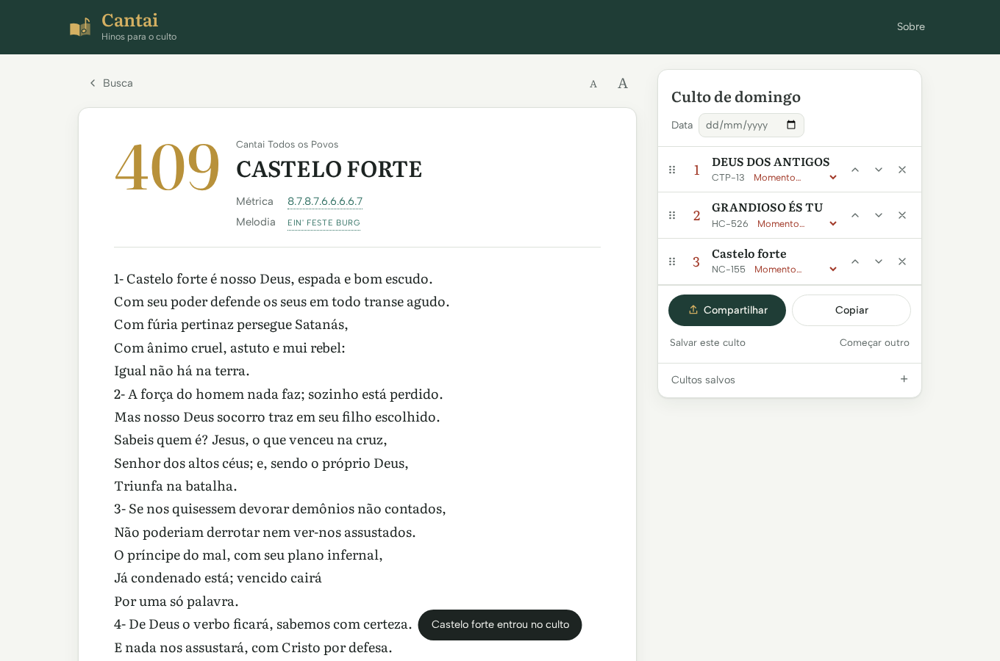
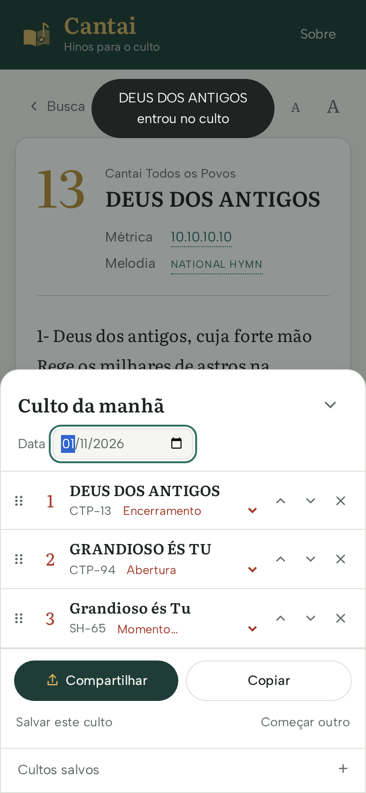

# Cantai

Selecionador de hinos para o culto: letra, métrica, melodia original, temas e
o mesmo hino em outros hinários. Ajuda a pianista a escolher as músicas.



## O que o app faz

- **Busca** por título, primeira linha, número ("sh 30", "ctp 314b") ou tema,
  nos cinco hinários de uma vez ou só nos marcados.
- **Página do hino**: letra (tamanho ajustável com A / A), métrica, melodia
  original e temas. Tocar na métrica ou na melodia lista os hinos que podem
  ser cantados com a mesma música, em qualquer hinário.
- **Em outros hinários**: o mesmo hino no CTP, HCC, SH, Harpa e Novo Cântico.
- **Culto**: o "+" ao lado de cada hino monta a ordem do culto. Dá para dar
  nome e data, marcar o momento (Abertura, Ofertório, Ceia…), arrastar para
  reordenar, compartilhar pelo WhatsApp e guardar cultos para reabrir depois.
  No celular, o culto fica numa barra embaixo da tela; no computador, ao lado.
- Modo escuro automático e instalação na tela inicial do celular.



## Hinários

| Código | Hinário | Hinos | Métrica/melodia |
|--------|---------|-------|-----------------|
| CTP | Cantai Todos os Povos | 504 | índice de métricas |
| HCC | Hinário para o Culto Cristão | 609 | índice de métricas |
| SH  | Salmos e Hinos | 621 | herdada do equivalente |
| HC  | Harpa Cristã | 640 | herdada do equivalente |
| NC  | Novo Cântico | 405 | herdada do equivalente |

Quando um hinário não traz métrica nem melodia, o hino herda as do mesmo
hino em outro hinário (CTP primeiro, depois HCC), e a tela mostra de onde veio.

## Como funciona

```
data/input/   PDFs e índices originais (fora do git)
     │  cantai importar-harpa | importar-nc | importar-metricas | importar-continuacoes-ctp
     ▼
data/base/    dados de base, versionados (não editar à mão)
     │  cantai build
     ▼
web/data/     o que o site publica (Netlify publica a pasta web/)
```

`cantai build` pode rodar quantas vezes quiser: não altera `data/base` e dá
sempre o mesmo resultado. As equivalências entre hinários são calculadas pelo
texto da letra (mesma sequência de palavras), mais o índice oficial CTP × SH.

## Uso

```bash
pip install -e ".[dev]"

PYTHONPATH=src python3 -m cantai.cli build      # gera web/data
PYTHONPATH=src python3 -m cantai.cli preview    # http://localhost:8000 (--port 8080 para outra porta)
python3 -m pytest                                # testes
```

## Antes de publicar

Rode `pytest`. Os testes conferem contagens, métricas conhecidas,
equivalências e se `web/data` está igual ao resultado do build. Se algum
falhar, algo que estava certo foi desfeito.

## Limitações conhecidas

- Traduções diferentes do mesmo hino original (ex.: "Castelo Forte" na Harpa
  e no CTP) não são ligadas, pois o texto é outro.
- O índice de temas da Harpa disponível está incompleto (403 de 640 hinos).
- O hino 378 do Novo Cântico não existe no PDF de origem.
- O HCC não tem tema de Natal no índice usado.

## Licença

[MIT License](LICENSE)
